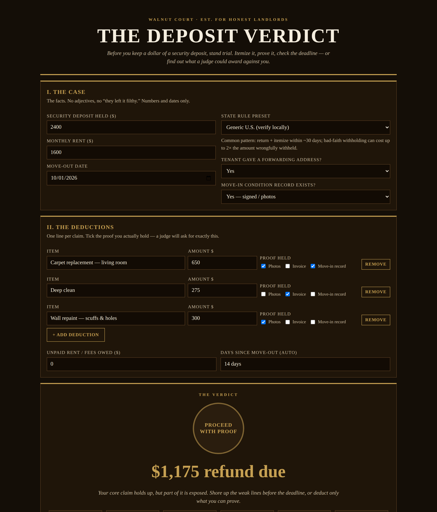

# The Deposit Verdict

**Live:** https://thebullbrew.github.io/deposit-verdict/
**Repo:** https://github.com/thebullbrew/deposit-verdict

## What it does

Before you keep a dollar of a security deposit, stand trial. Enter the deposit, the move-out date, and your state, itemize every deduction with the proof you actually hold (photos, invoices, move-in record), and the court delivers its verdict: refund due, refund deadline, documentation score, how much of your claim is at risk on weak proof, and your worst-case exposure if a judge applies your state's penalty multiplier — up to 2× or 3× the amount wrongfully withheld.

Verdicts come as a gold seal: **Clean Verdict**, **Proceed With Proof**, **Court Bait**, or **Overdue — Exposed**. Includes state presets (NJ, NY, CA, PA, FL, TX + generic U.S.), a penalty sensitivity table, saveable per-unit cases (localStorage), and a copyable summary for the itemized statement you mail the tenant.

## The method behind it

Deposits are lost in court for three boring reasons, not bad intentions: a missed deadline, no move-in record, and deductions priced new-for-old with no invoice. This tool prices each line by its evidence — two or more forms of proof counts as strong, zero or one counts as at-risk — and runs the deadline and penalty math before the tenant's lawyer does. Normal wear and tear is not damage, in any courtroom.

Educational calculator, not legal advice. State and city laws vary — verify your deadline locally.

## How to run

Open `docs/index.html` in any browser, or serve `docs/` with any static host. Works offline as a PWA after first load. No backend, no accounts, no data leaves the device.

Dark aesthetic: Variation 19 — Walnut Court.
